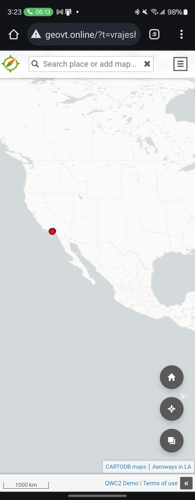
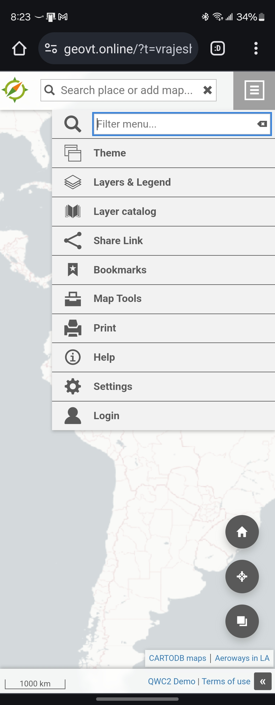
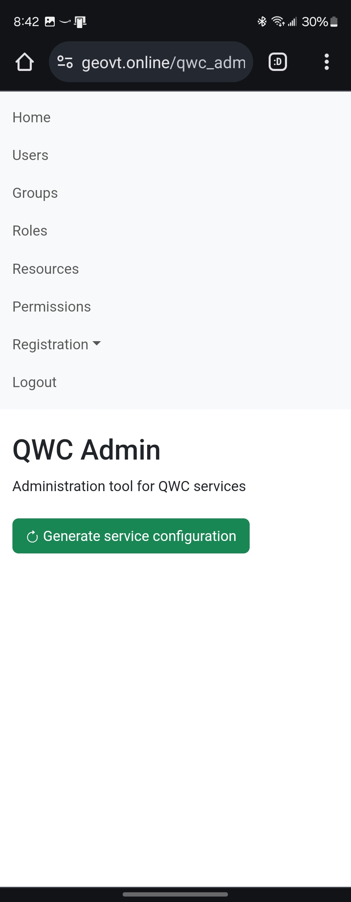

# Geovt.online — QWC2 & QGIS Server Web GIS Stack

Dockerized **QWC2** (QGIS Web Client 2, built with React and OpenLayers) paired with **QGIS Server**, PostgreSQL/PostGIS, Azure Ubuntu deployment documentation, and Cloudflare SSL configuration.

---

## Screenshots

<p align="center">
  
  
  
</p>

---

## Architecture & Stack

- **Web Client:** QWC2 (`React` + `OpenLayers`)
- **Map Engine & Database:** `QGIS Server` + `PostgreSQL / PostGIS` + Apache (`config/httpd.conf`)
- **Container Stack:** Docker Compose (`qwc-docker/docker-compose.yml`)
- **Hosting & Edge Security:** Ubuntu Linux VM on Microsoft Azure + Cloudflare DNS/SSL

---

## Quick Start (Docker Compose)

1. Copy the environment template and generate a JWT secret (`openssl rand -hex 48`):

```bash
cd qwc-docker
cp .env.example .env
```

2. Review database credentials in `qwc-docker/docker-compose.yml` (`POSTGRES_PASSWORD`) and start the stack:

```bash
docker compose up -d
```

3. See `qwc-docker/README.md` for service endpoints, volume mounts, and QWC2 admin login details.

---

## Step-by-Step Deployment Guides

| Guide | Topic |
| :--- | :--- |
| [Deployment Methods](docs/deployment-methods.md) | Pros and cons of Standalone Viewer, QWC2 Docker, and Cloud-Hosted options |
| [01 — Connect PostGIS](docs/guides/01-connect-postgis-to-postgresql.pdf) | Connecting PostgreSQL/PostGIS layers to QGIS |
| [02 — Configure QGIS Server](docs/guides/02-configure-qgis-server-apache.pdf) | Apache (`config/httpd.conf`) + OSGeo4W QGIS Server setup |
| [03 — Azure Ubuntu Setup](docs/guides/03-initialize-azure-ubuntu-server.pdf) | Provisioning an Ubuntu web server VM on Microsoft Azure |
| [04a — QWC2 Docker on Ubuntu](docs/guides/04a-install-qwc2-docker-ubuntu-azure.pdf) | Installing and running QWC2 Docker on Azure Ubuntu |
| [04b — QWC2 Docker on Windows](docs/guides/04b-install-qwc2-docker-windows.pdf) | Running QWC2 Docker locally on Windows |
| [05 — Cloudflare SSL](docs/guides/05-ssl-cloudflare-setup.pdf) | Configuring Cloudflare DNS and SSL termination |
| [06 — QWC2 Admin Login](docs/guides/06-login-qwc2-admin.pdf) | Accessing the QWC2 Admin GUI |

---

## Repository Structure

```text
├── qwc-docker/               # Docker Compose stack, API gateway, and volume configs
├── config/httpd.conf         # Apache configuration for QGIS Server
├── docs/
│   ├── deployment-methods.md # Comparison of QWC2 deployment patterns
│   ├── guides/               # Step-by-step PDF setup guides
│   └── screenshots/          # Live deployment screenshots
└── .gitignore
```
